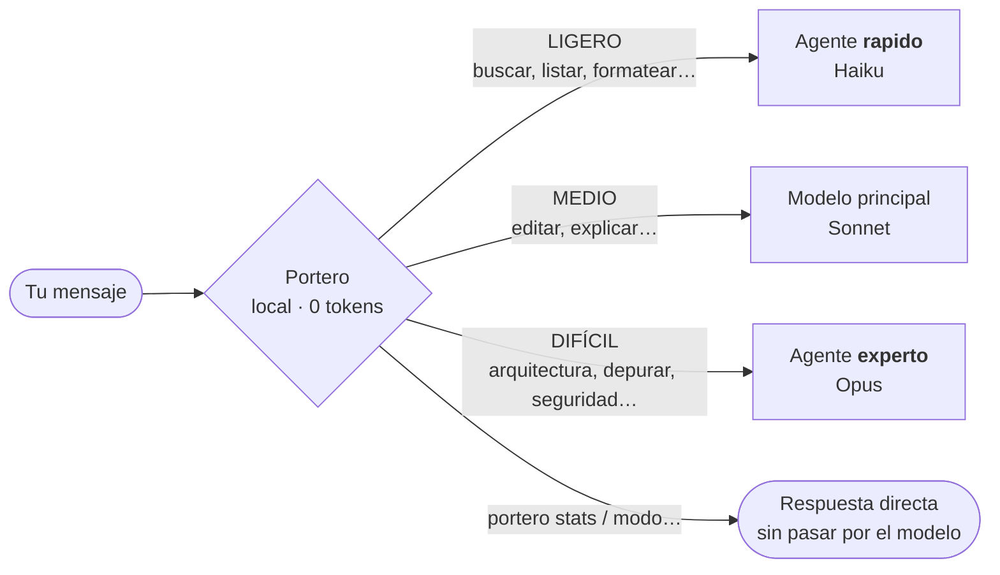

<div align="center">

# 🚪 claude-portero

**Enrutador de modelos para Claude Code que clasifica cada mensaje en local, con 0 tokens.**
Las tareas mecánicas van a Haiku, las normales a Sonnet y solo las difíciles a Opus.


</div>

---

## El problema

Usar siempre el modelo más potente es la forma más cara de trabajar con un asistente de IA. Pedirle a Opus que liste archivos o que renombre una variable cuesta lo mismo por token que pedirle que diseñe una arquitectura. Pedirle a Haiku que depure una condición de carrera sale barato, pero sale mal.

## La solución

El **portero** es un *hook* `UserPromptSubmit` de Claude Code. Antes de que tu mensaje llegue al modelo, un clasificador en Python puro lo puntúa **en tu máquina** (sin llamar a ninguna API, 0 tokens) y añade una directiva de enrutado:



La **skill `enrutador`** completa el sistema: el portero clasifica el mensaje entero y el enrutador reparte las *subtareas* de un trabajo largo (por ejemplo, el «busca todos los usos» a Haiku y el «rediseña el módulo» a Opus).

## Resultados reales

Datos de mi propio uso durante 12 días (el log solo guarda el nivel y la longitud de cada mensaje, nunca el texto):

| Nivel | Modelo | Mensajes | % |
|---|---|---:|---:|
| LIGERO | Haiku | 168 | 20,5 % |
| MEDIO | Sonnet | 622 | 75,9 % |
| DIFÍCIL | Opus | 29 | 3,5 % |
| **Total** | | **819** | |

Con un coste relativo aproximado de Haiku ≈ 1/20 y Sonnet ≈ 1/2 respecto a Opus, eso supone **un ~57 % menos de coste estimado que mandarlo todo a Opus**, sin renunciar a Opus cuando hace falta. (Es una estimación por número de mensajes, no una medición de facturación.)

## Instalación

```bash
git clone https://github.com/raulhernandezherce/claude-portero.git
```

```bash
cd claude-portero && bash install.sh
```

El instalador copia los archivos a `~/.claude`, hace una copia de seguridad de tu `settings.json` y registra el hook. Es idempotente: si lo ejecutas dos veces no duplica nada.

## Uso

Escribe con normalidad. Además, puedes usar estos comandos en el chat de Claude Code (los responde el portero, no llegan al modelo y no gastan tokens):

| Comando | Qué hace |
|---|---|
| `portero` | Muestra el estado y el modo actual |
| `portero modo ahorro` | Casi todo a Haiku; Opus solo si es muy difícil |
| `portero modo equilibrado` | Modo por defecto |
| `portero modo calidad` | Más tareas a Opus |
| `portero modo off` | Desactiva el portero |
| `portero stats` | Reparto por modelo y ahorro estimado |
| `portero probar <texto>` | Muestra cómo clasificaría un texto y por qué |
| `!haiku` / `!sonnet` / `!opus` | Al principio de un mensaje, fuerza el modelo |

## Cómo clasifica

Un sistema de puntos transparente, sin caja negra:

- **+2** por cada palabra clave de tarea difícil (*arquitectura, depurar, seguridad, migración, rendimiento, deadlock…*), hasta 3.
- **−2** por cada palabra clave de tarea ligera (*lista, busca, renombra, formatea, resume…*), hasta 2.
- **+1/+2** si el mensaje es largo, **+1** si incluye código o nombra varios archivos, **−1** si es muy corto.
- Los umbrales dependen del modo. Para mandar algo a Haiku hace falta además una señal **explícita** de tarea ligera: ante la duda, el mensaje se queda en el modelo principal.

Las palabras clave y los modelos se pueden cambiar en `~/.claude/portero/config.json`.

## Estructura

```
portero/portero.py        hook UserPromptSubmit (Python puro, sin dependencias)
skills/enrutador/SKILL.md skill que reparte subtareas entre niveles
agents/rapido.md          subagente Haiku para tareas mecánicas
agents/experto.md         subagente Opus para tareas difíciles
install.sh                instalador idempotente con copia de seguridad
tests/                    tests que ejecutan el hook igual que Claude Code
```

## Privacidad

El portero no se conecta a internet. El log (`~/.claude/portero/log.jsonl`) guarda la hora, el nivel, la puntuación y la longitud del mensaje, **nunca su contenido**. Hay un test que lo comprueba.

## Tests

```bash
python3 -m unittest discover -s tests -v
```

---

<sub>Hecho por <a href="https://github.com/raulhernandezherce">Raúl Hernández Herce</a> · Licencia MIT</sub>
